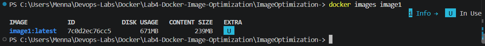
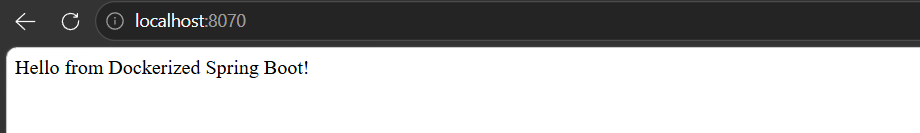
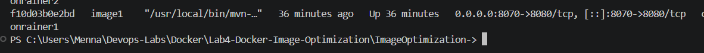
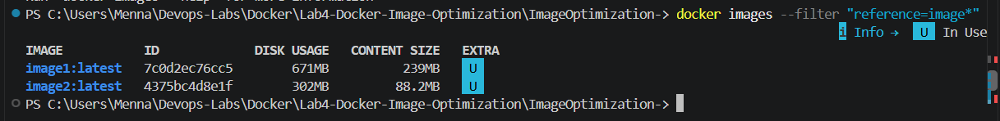
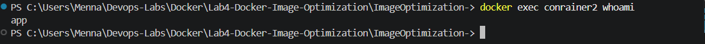
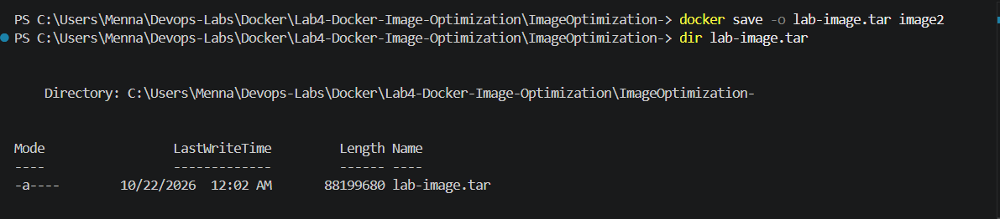
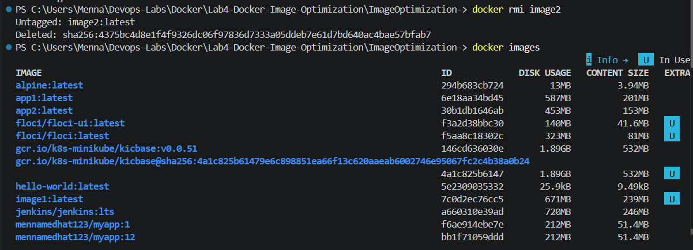
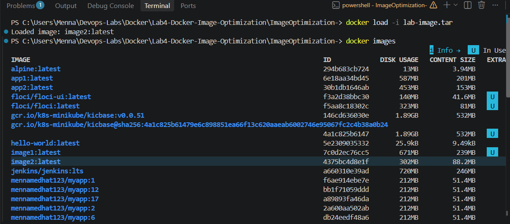

# Lab 4: Docker Image Optimization and Export/Load

## Objective

Build a Spring Boot (Java 17 / Maven) application as a Docker image, then optimize it with a **multi-stage build** that runs as a **non-root user**, compare the image sizes, and finally practice exporting an image to a TAR file and loading it back.

## Project Structure

```
Lab4-Docker-Image-Optimization/
├── README.md
├── ImageOptimization-/
│   ├── Dockerfile               # Original single-stage Dockerfile (image1)
│   ├── Dockerfile.multistage    # Optimized multi-stage Dockerfile (image2)
│   ├── pom.xml
│   └── src/
└── screenshots/
```

Application source: https://github.com/Ibrahim-Adel15/ImageOptimization-

## Results

| Image  | Dockerfile              | Size        | Runs as      |
|--------|-------------------------|-------------|--------------|
| image1 | `Dockerfile`            | `<SIZE_1>`  | root         |
| image2 | `Dockerfile.multistage` | `<SIZE_2>`  | `app` (non-root) |

**Size reduction:** `<SIZE_1>` → `<SIZE_2>`

> Replace the placeholders with the values shown by `docker images`.

## Dockerfiles

### Original Dockerfile (image1)

```dockerfile
FROM maven:3.9.15-eclipse-temurin-17-alpine
WORKDIR /app
COPY . .
RUN mvn package
EXPOSE 8080
CMD ["java", "-jar", "target/demo-0.0.1-SNAPSHOT.jar"]
```

This image keeps Maven, the full JDK, the source code, and all downloaded dependencies, even though only the final `.jar` is needed at runtime.

### Optimized Dockerfile (image2)

```dockerfile
# Stage 1: build
FROM maven:3.9.15-eclipse-temurin-17-alpine AS builder
WORKDIR /build
COPY pom.xml .
RUN mvn dependency:go-offline -B
COPY src ./src
RUN mvn clean package -DskipTests

# Stage 2: runtime
FROM eclipse-temurin:17-jre-alpine
WORKDIR /app
COPY --from=builder /build/target/demo-0.0.1-SNAPSHOT.jar app.jar
RUN addgroup -S app && adduser -S app -G app
USER app
EXPOSE 8080
ENTRYPOINT ["java", "-jar", "app.jar"]
```

**Why it is smaller and safer:**

- **Multi-stage build:** the first stage compiles the app with Maven and the JDK. The second stage starts from a small JRE-only image and copies in just the final `.jar`, so build tools and source code are left behind.
- **Layer caching:** `pom.xml` is copied and dependencies are downloaded before the source code, so dependencies are cached unless `pom.xml` changes.
- **Non-root user:** a dedicated `app` user is created and the container runs with `USER app`, which limits the impact of a compromised application.

## Steps

### 1. Clone the application and build image1

```bash
git clone https://github.com/Ibrahim-Adel15/ImageOptimization-.git
cd ImageOptimization-
docker build -t image1 .
```

### 2. Note the size of image1 and run container1

```bash
docker images image1
docker run -d --name container1 -p 8080:8080 image1
```

### 3. Verify the application, then stop and delete the container

```bash
docker ps
docker logs container1
docker stop container1
docker rm container1
```

The log line `Started DemoApplication` confirms the application is running.

### 4. Build the optimized image (image2) and compare sizes

```bash
docker build -f Dockerfile.multistage -t image2 .
docker images
```

### 5. Run container2 and verify it runs as non-root

```bash
docker run -d --name container2 -p 8080:8080 image2
docker logs container2
docker exec container2 whoami
docker exec container2 id
```

`whoami` returns `app`, not `root`.

### 6. Stop and delete container2

```bash
docker stop container2
docker rm container2
```

### 7. Save image2 as a TAR file

```bash
docker save -o lab-image.tar image2
```

### 8. Delete image2 from the local Docker host

```bash
docker rmi image2
docker images
```

### 9. Load the image from the TAR file and verify

```bash
docker load -i lab-image.tar
docker images
```

`image2` is back in the local image list.

> `lab-image.tar` is excluded from the repository through `.gitignore` (`*.tar`) because of its size.

## Screenshots

### image1 build


### image1 size and container1 running


### Application verified (logs)


### container1 created and running
 

### image2 build (multi-stage)


### Size comparison: image1 vs image2


### container2 running as non-root


### Save image2 as TAR


### Delete image2


### Load image from TAR and verify


## Key Takeaways

- Multi-stage builds keep build tools out of the final image, which makes it smaller.
- Running as a non-root user is a simple and effective security hardening step.
- `docker save` and `docker load` let you move images between machines without a registry.