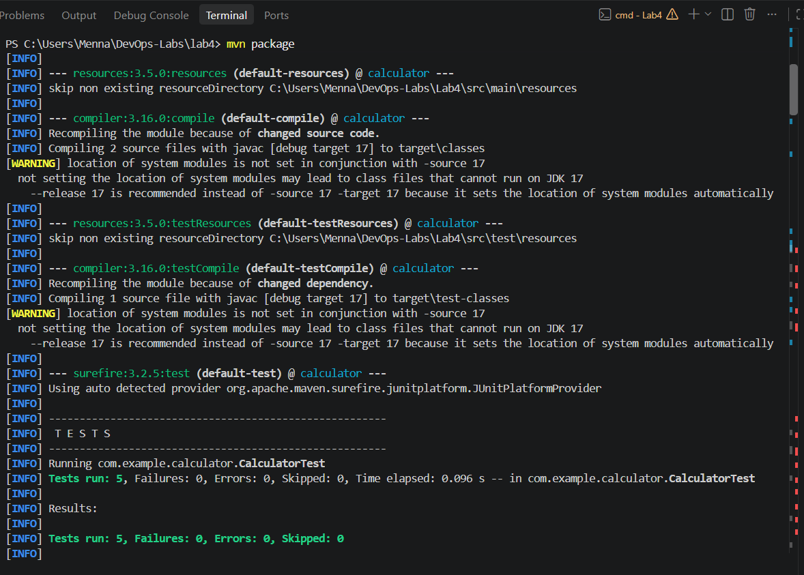
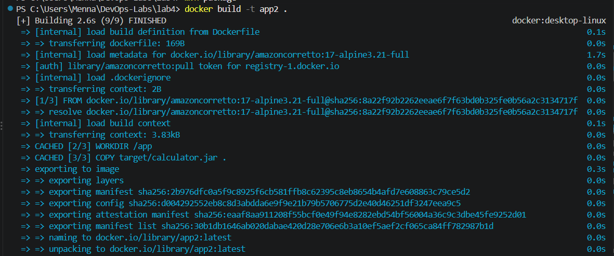
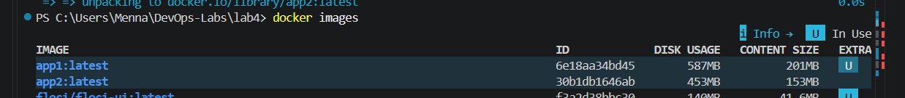
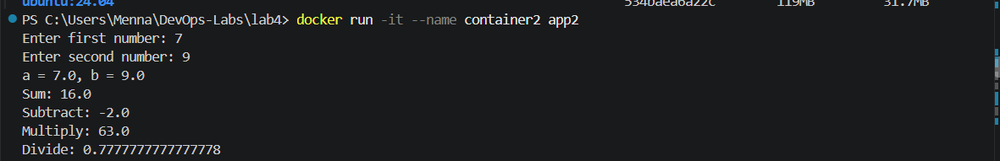

# Lab 4: Creating a Docker Image for a Java Application (Part 2: Build Locally)

## Objective

Build the Java calculator application **locally** with Maven, then copy the generated JAR into a Java 17 runtime image. The container runs as a **non-root user**.

## Source Code

Repository: https://github.com/Ibrahim-Adel15/CalculatorMavenApp.git

```powershell
git clone https://github.com/Ibrahim-Adel15/CalculatorMavenApp.git Lab4
cd Lab4
```

## Step 1: Build the application locally

```powershell
mvn package
```

This generates `target/calculator.jar`. The `target` folder is not stored in Git, so this step must be run before building the image.

## Dockerfile

```dockerfile
FROM amazoncorretto:17-alpine3.21-full

RUN adduser -D appuser
WORKDIR /app
COPY --chown=appuser:appuser target/*.jar app.jar

USER appuser
EXPOSE 8080
CMD ["java", "-jar", "app.jar"]
```

### Explanation

- `FROM amazoncorretto:17-alpine3.21-full`: Java 17 runtime image based on Alpine Linux.
- `RUN adduser -D appuser`: creates a non-root user (Alpine uses `adduser` instead of `useradd`).
- `WORKDIR /app`: sets the working directory.
- `COPY --chown=appuser:appuser target/*.jar app.jar`: copies the locally built JAR and gives the user ownership.
- `USER appuser`: the container runs as `appuser`.
- `EXPOSE 8080`: documents the application port.
- `CMD`: runs the JAR.

No Maven and no source code are included in the image.

## Steps

### 1. Build the image `app2`

```powershell
docker build -t app2 .
```

### 2. Note the image size

```powershell
docker images
```

**Image size of app2:** `<write the size from docker images>`

### 3. Run `container2`

```powershell
docker run -it --name container2 app2
```

### 4. Verify the application and the user

Enter two numbers and check the results. Then verify that the container does not run as root:

```powershell
docker run --rm app2 whoami
```

The output must be `appuser`.

### 5. Delete the container and the image

```powershell
docker rm -f container2
docker rmi app2
```

## Screenshots

### Local build



### Docker build



### Image size



### Running the container



## Bonus: Comparing the Two Approaches

- **app1** (Lab 3): size `<201MB>`
- **app2** (Lab 4): size `<153MB>`

**Part 1: build inside Docker (app1)**

- The image contains Maven, the full JDK, the source code, and the downloaded dependencies, so it is much larger.
- The build is self-contained and reproducible: anyone with Docker can build it without installing Java or Maven.
- Slower builds and a bigger attack surface, because build tools and source code ship with the image.

**Part 2: build locally (app2)**

- The image contains only a Java runtime and the JAR, so it is much smaller.
- Faster to build, push, and pull, and more secure.
- Requires Java and Maven on the local machine, and the result depends on that machine's environment.

**Conclusion:** building inside Docker favors reproducibility, while building locally and copying the JAR gives a smaller and safer image. A multi-stage build combines both advantages: build with Maven in one stage, then copy only the JAR into a small runtime image.