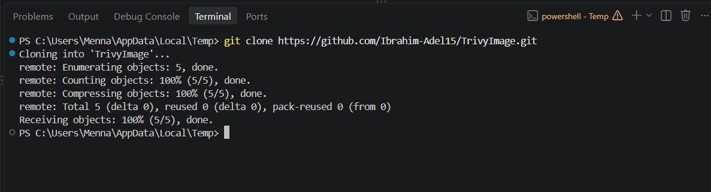
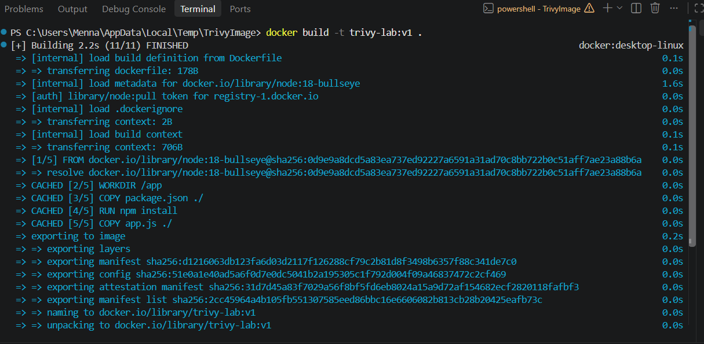
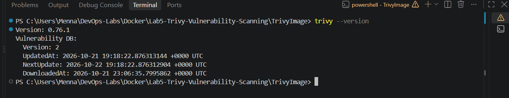
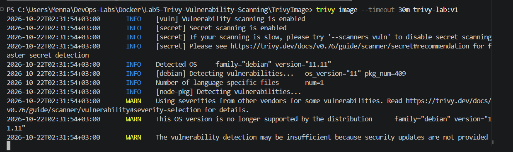
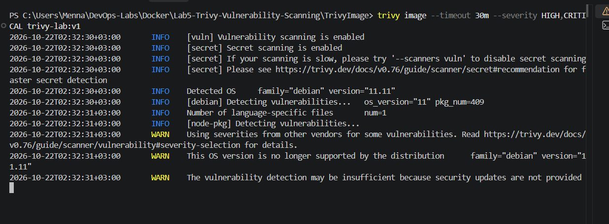
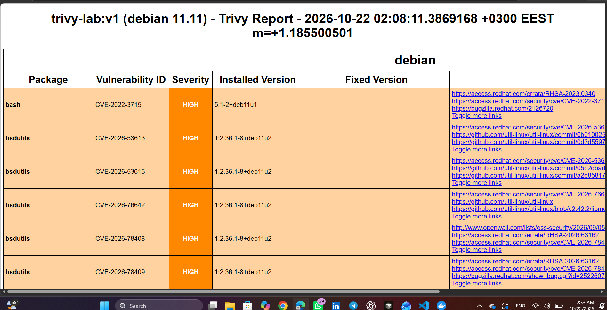
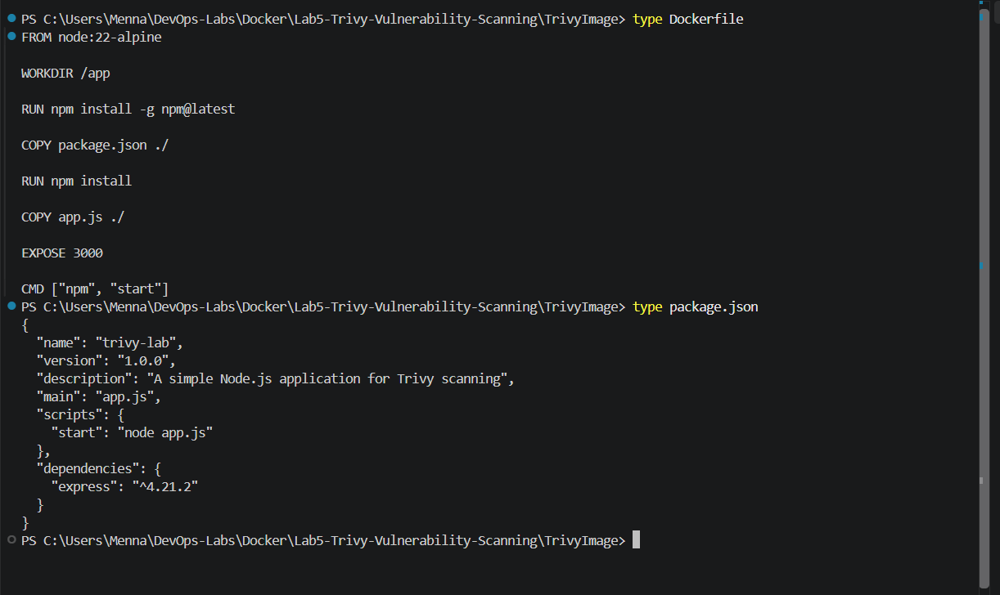
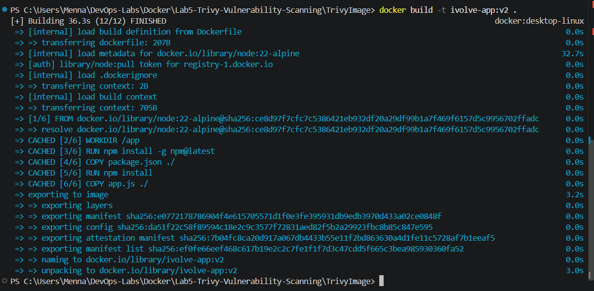
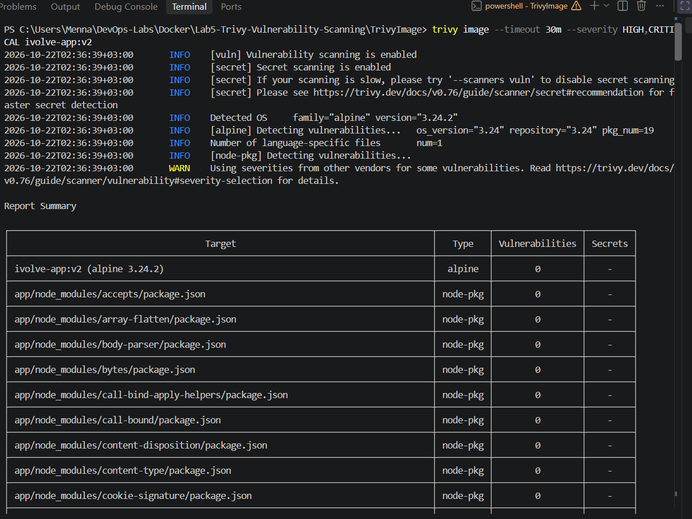
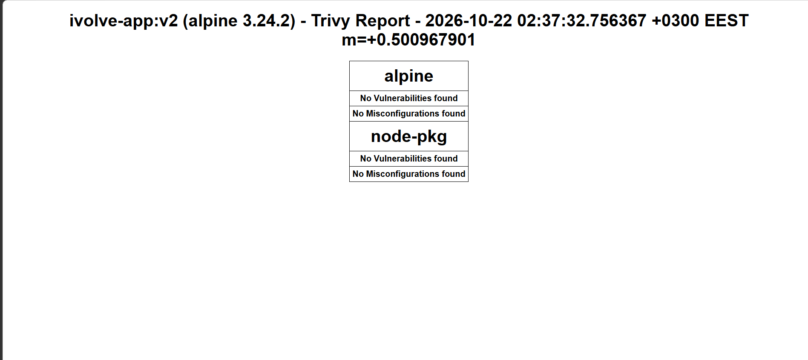

# Lab 5: Docker Image Vulnerability Scanning with Trivy

## Objective

Build a Docker image for a Node.js application, scan it for known vulnerabilities with **Trivy**, focus on the **HIGH** and **CRITICAL** findings, and generate an HTML report. In the bonus part, remediate the findings by updating the base image and application dependencies, rebuild the image, and rescan to verify the fix.

## Project Structure

```
Lab5-Trivy-Vulnerability-Scanning/
├── README.md
├── TrivyImage/              # Application code and Dockerfile
│   ├── Dockerfile
│   ├── package.json
│   └── app.js
├── reports/
│   ├── report-v1.html       # Scan of trivy-lab:v1 (before fixing)
│   └── report-v2.html       # Scan of ivolve-app:v2 (after fixing)
└── screenshots/
```

Application source: https://github.com/Ibrahim-Adel15/TrivyImage

## Results

| Image           | Base image                          | Express   | HIGH | CRITICAL |
|-----------------|-------------------------------------|-----------|------|----------|
| `trivy-lab:v1`  | `node:18-bullseye` (Debian 11.11)   | `4.18.2`  | 2133 | 222      |
| `ivolve-app:v2` | `node:22-alpine` (Alpine 3.24.2)    | `^4.21.2` | 0    | 0        |

Breakdown of the original findings (`trivy-lab:v1`):

| Source                    | HIGH | CRITICAL |
|---------------------------|------|----------|
| Debian OS packages        | 2107 | 221      |
| Node.js packages (npm)    | 26   | 1        |

> Vulnerability counts change over time as the Trivy database is updated. The numbers above come from the scans taken during this lab.

---

## Part 1: Scanning

### 1. Clone the application and build the image

```bash
git clone https://github.com/Ibrahim-Adel15/TrivyImage.git
cd TrivyImage
docker build -t trivy-lab:v1 .
```

Original `Dockerfile`:

```dockerfile
FROM node:18-bullseye

WORKDIR /app

COPY package.json ./

RUN npm install

COPY app.js ./

EXPOSE 3000

CMD ["npm", "start"]
```

**Clone**



**Build `trivy-lab:v1`**



### 2. Install Trivy and verify the installation

Trivy was installed on Windows using Scoop.

```powershell
scoop install trivy
trivy --version
```



### 3. Scan the image for vulnerabilities

```bash
trivy image trivy-lab:v1
```

The first scan downloads the vulnerability database. The output lists each affected package, its CVE ID, severity, installed version, and the version that fixes it when one exists.



### 4. Scan for HIGH and CRITICAL vulnerabilities only

```bash
trivy image --severity HIGH,CRITICAL trivy-lab:v1
```



### 5. Generate an HTML report

```bash
trivy image --severity HIGH,CRITICAL --format template --template "@contrib/html.tpl" -o report-v1.html trivy-lab:v1
```

> On a slow connection, add `--timeout 30m` so the database download and scan do not time out. With Scoop, the template is at `%USERPROFILE%\scoop\apps\trivy\current\contrib\html.tpl`.



The report is saved in [`reports/report-v1.html`](reports/report-v1.html).

---

## Part 2 (Bonus): Vulnerability Remediation

### 1. Investigate the detected vulnerabilities

The report shows that almost all findings come from the base image:

- **Outdated and oversized base image:** `node:18-bullseye` is built on Debian 11 and includes many packages the app never uses (for example `imagemagick`, `git`, `curl`, `gnupg`). `linux-libc-dev` alone accounts for 887 findings, and about half of the Debian findings had no fix available.
- **Outdated application dependency:** `express` was pinned to `4.18.2`, which pulls in vulnerable `body-parser` (1.20.1) and `path-to-regexp` (0.1.7).
- **Outdated npm bundled packages:** `tar`, `minimatch`, `glob`, `brace-expansion`, and others inside the npm that ships with Node 18.

### 2. Fix the issues

| File           | Before                     | After                                                      |
|----------------|----------------------------|------------------------------------------------------------|
| `Dockerfile`   | `FROM node:18-bullseye`    | `FROM node:22-alpine`                                      |
| `Dockerfile`   | (none)                     | `RUN npm install -g npm@latest`                            |
| `package.json` | `"express": "4.18.2"`      | `"express": "^4.21.2"`                                     |

Updated `Dockerfile`:

```dockerfile
FROM node:22-alpine

WORKDIR /app

RUN npm install -g npm@latest

COPY package.json ./

RUN npm install

COPY app.js ./

EXPOSE 3000

CMD ["npm", "start"]
```

Updated `package.json`:

```json
{
  "name": "trivy-lab",
  "version": "1.0.0",
  "description": "A simple Node.js application for Trivy scanning",
  "main": "app.js",
  "scripts": {
    "start": "node app.js"
  },
  "dependencies": {
    "express": "^4.21.2"
  }
}
```

The first rebuild (new base image and Express) removed all OS and application findings and left 10 HIGH findings inside the npm that is bundled with the image. Updating npm itself (`npm install -g npm@latest`) cleared those as well.



### 3. Rebuild the image as `ivolve-app:v2`

```bash
docker build -t ivolve-app:v2 .
```



### 4. Rescan the updated image and generate a new report

```bash
trivy image --severity HIGH,CRITICAL ivolve-app:v2
trivy image --severity HIGH,CRITICAL --format template --template "@contrib/html.tpl" -o report-v2.html ivolve-app:v2
```

The summary shows `0` vulnerabilities for the Alpine OS packages, the application dependencies (`app/node_modules`), and the npm packages.





The report is saved in [`reports/report-v2.html`](reports/report-v2.html).

### 5. Verify the remediation

No HIGH or CRITICAL vulnerabilities remain in `ivolve-app:v2`, so nothing is left to exclude even when fixes are not available.

---

## Key Takeaways

- Scanning images before deployment catches known CVEs early.
- Filtering by severity (`--severity HIGH,CRITICAL`) keeps the focus on what matters most.
- Choosing a small, current base image (`node:22-alpine`) removed the vast majority of findings in a single change.
- Pinning dependencies to old exact versions keeps known vulnerabilities in the image, so dependencies need regular updates.
- Tools bundled inside the base image (like npm) can have their own findings, so they are worth checking too.
- Rescanning after every change proves the remediation worked.