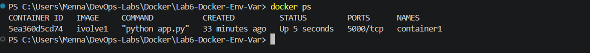
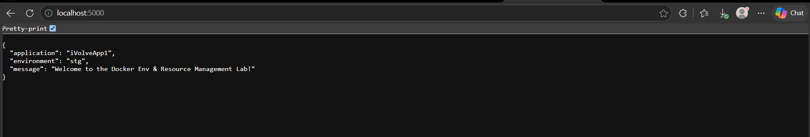
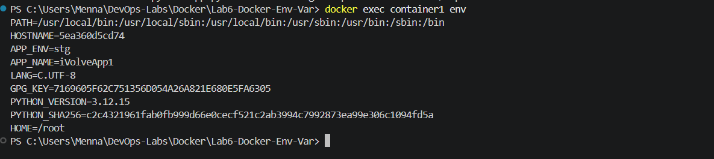
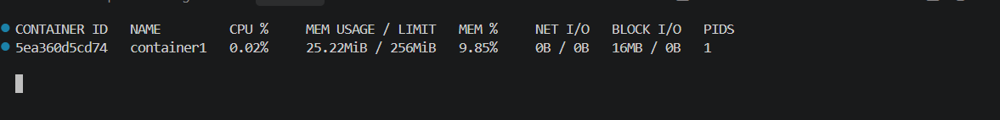
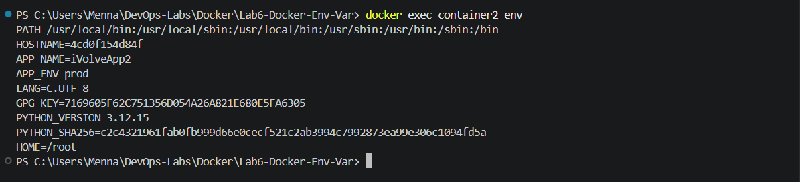
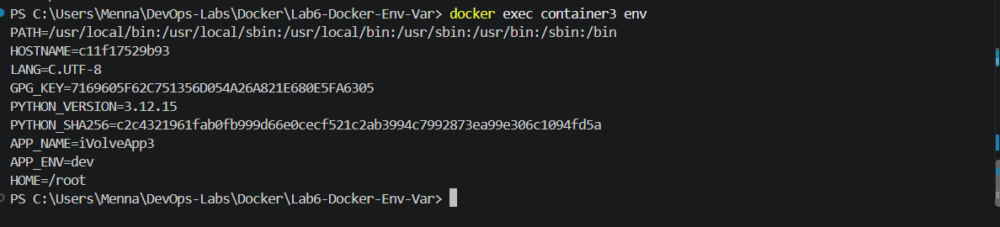

# Lab 6: Docker Environment Variables and Resource Management

Containerizing a Python (Flask) application with Docker, passing configuration through **environment variables** in three different ways, and **limiting container resources** (CPU and memory).

## Objectives

- Write a Dockerfile for a Python app using the `python:3.12-slim` base image
- Pass environment variables with `-e`, with `--env-file`, and with `ENV` in the Dockerfile
- Limit a container to **1 CPU** and **256 MB** of memory
- Verify the app, the environment variables, and resource usage

## Project Structure

```
Lab6-Docker-Env-Var/
├── README.md
├── screenshots/            # Evidence screenshots referenced below
└── PythonApp/
    ├── app.py              # Flask application (listens on 0.0.0.0:5000)
    ├── requirements.txt    # Python dependencies
    ├── Dockerfile          # Used for ivolve1, then edited (ENV lines added) for ivolve3
    └── env.txt             # Environment variables file for container2
```

## Prerequisites

- Docker Desktop (running)
- Git

## Steps

### 1. Clone the application

```bash
git clone https://github.com/Ibrahim-Adel15/PythonApp.git
cd PythonApp
```

### 2. Create the Dockerfile

```dockerfile
FROM python:3.12-slim

WORKDIR /app

COPY requirements.txt .
RUN pip install --no-cache-dir -r requirements.txt

COPY . .

EXPOSE 5000

CMD ["python", "app.py"]
```

**Why `requirements.txt` is copied first:** Docker caches each layer. Installing dependencies only needs `requirements.txt`, so copying it separately means the `pip install` layer is reused from cache whenever only the source code changes. The less frequently changing steps go first.

### 3. Build the image

```bash
docker build -t ivolve1 .
```


### 4. Run `container1` with `-e` and resource limits

```bash
docker run -d --name container1 -p 5000:5000 \
  -e APP_NAME=iVolveApp1 \
  -e APP_ENV=stg \
  --cpus="1" \
  --memory="256m" \
  ivolve1
```

| Flag | Purpose |
|------|---------|
| `-d` | Run in the background |
| `--name container1` | Name of the container |
| `-p 5000:5000` | `host_port:container_port`. The right side must match the port the app listens on |
| `-e KEY=VALUE` | Set an environment variable |
| `--cpus="1"` | Limit to one CPU core |
| `--memory="256m"` | Limit memory to 256 MB (the container is killed if it exceeds it) |




### 5. Verify `container1`

Application:

```bash
curl http://localhost:5000
```



Environment variables:

```bash
docker exec container1 env
# or only the relevant ones (PowerShell):
docker exec container1 env | findstr APP_
```



Resource usage:

```bash
docker stats container1
# single reading:
docker stats --no-stream container1
```



The `MEM USAGE / LIMIT` column should show a limit of `256MiB`. To confirm both limits were applied:

```bash
docker inspect container1 --format "CPUs: {{.HostConfig.NanoCpus}}  Memory: {{.HostConfig.Memory}}"
```

### 6. Run `container2` with an env file

Create `env.txt` (no spaces around `=`, no quotes):

```
APP_NAME=iVolveApp2
APP_ENV=prod
```

Stop `container1` first so port 5000 is free, then run:

```bash
docker stop container1
docker run -d --name container2 -p 5000:5000 --env-file env.txt ivolve1
docker exec container2 env
```



### 7. Build an image with hardcoded variables

The same `Dockerfile` is edited: two `ENV` instructions are added (before `EXPOSE`), then the image is rebuilt under a new name.

```dockerfile
FROM python:3.12-slim

WORKDIR /app

COPY requirements.txt .
RUN pip install --no-cache-dir -r requirements.txt

COPY . .

ENV APP_NAME=iVolveApp3
ENV APP_ENV=dev

EXPOSE 5000

CMD ["python", "app.py"]
```

```bash
docker build -t ivolve3 .
```


`ivolve1` is not affected by this edit. An image is immutable, so it keeps the Dockerfile contents from when it was built (without the `ENV` lines).

### 8. Run `container3` from `ivolve3`

The lab text reuses the name `container2` for this step, but that name is already taken by the container from step 6. A separate name (`container3`) is used here so all three containers can be compared side by side. Stop `container2` first so port 5000 is free:

```bash
docker stop container2
docker run -d --name container3 -p 5000:5000 ivolve3
docker exec container3 env
```



Expected variables:

```
APP_NAME=iVolveApp3
APP_ENV=dev
```

## Result

All three containers in Docker Desktop:


## Ways to Pass Environment Variables

| Method | Where it is defined | Best for |
|--------|---------------------|----------|
| `-e KEY=VALUE` | `docker run` command | A few values, quick overrides |
| `--env-file file` | A file on the host | Many values, one file per environment |
| `ENV KEY=VALUE` | Dockerfile (baked into the image) | Defaults that belong to the image |

Precedence: values passed at runtime (`-e` / `--env-file`) override `ENV` values from the Dockerfile.

## Troubleshooting

- **`executable file not found in $PATH`**: the Dockerfile used `"Python"` instead of `"python"`. Linux is case-sensitive. Fix the `CMD` and rebuild, since a running container uses the already-built image, not the Dockerfile.
- **App unreachable on `localhost:5000`**: check that the right side of `-p` matches the port in `app.py`, and that the app binds to `0.0.0.0` (not `127.0.0.1`).
- **Container name already in use**: remove the old container with `docker rm -f <name>`.
- **Port already allocated**: stop the container that is using port 5000, or map a different host port (for example `-p 8080:5000`).

## Cleanup

```bash
docker rm -f container1 container2 container3
docker rmi ivolve1 ivolve3
```

## Key Takeaways

- The container port in `-p` must match the port the application actually listens on.
- Layer ordering in a Dockerfile affects build speed through caching.
- Resource limits (`--cpus`, `--memory`) are enforced by Docker and can be checked with `docker stats` and `docker inspect`.
- Rebuild the image after changing the Dockerfile; running containers do not pick up changes.