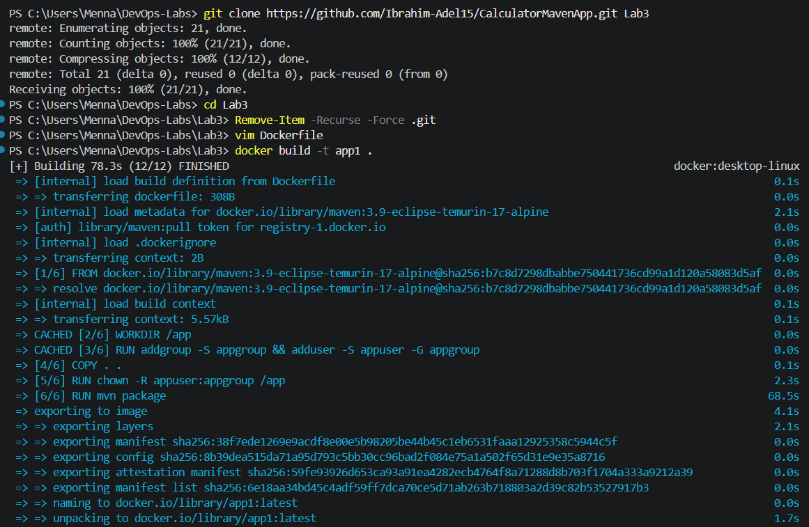
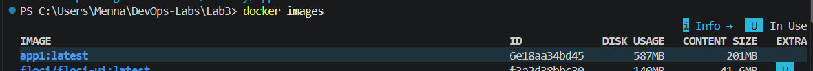
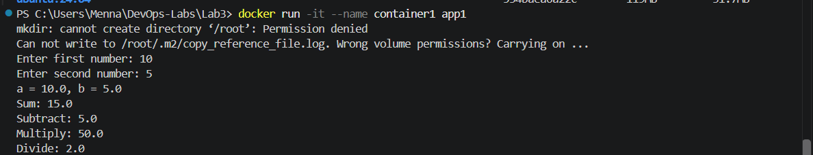

# Lab 3: Creating a Docker Image for a Java Application (Part 1: Build Inside Docker)

## Objective

Build the Java calculator application **inside Docker** using a Maven image with Java 17, and run the container as a **non-root user**.

## Source Code

Repository: https://github.com/Ibrahim-Adel15/CalculatorMavenApp.git

```powershell
git clone https://github.com/Ibrahim-Adel15/CalculatorMavenApp.git Lab3
cd Lab3
```

## Dockerfile

```dockerfile
FROM maven:3.9-eclipse-temurin-17-alpine

WORKDIR /app

RUN addgroup -S appgroup && adduser -S appuser -G appgroup

COPY . .

RUN chown -R appuser:appgroup /app

RUN mvn package

CMD ["java", "-jar", "target/calculator.jar"]

USER appuser

EXPOSE 8080

### Explanation

- `FROM maven:3.9-eclipse-temurin-17`: Maven image with Java 17 (JDK).
- `RUN useradd -m appuser`: creates a non-root user with a home directory (Maven needs it for `~/.m2`).
- `WORKDIR /app`: sets the working directory.
- `COPY . .`: copies the source code into the image.
- `RUN chown -R appuser:appuser /app`: gives the user ownership of the application files.
- `USER appuser`: all following instructions, and the container itself, run as `appuser`.
- `RUN mvn package`: builds the JAR inside the image.
- `EXPOSE 8080`: documents the application port.
- `ENTRYPOINT []`: removes the Maven image's default entrypoint so the JAR runs directly.
- `CMD`: runs the generated JAR.

## Steps

### 1. Build the image `app1`

```powershell
docker build -t app1 .
```

### 2. Note the image size

```powershell
docker images
```

**Image size of app1:** `<write the size from docker images>`

### 3. Run `container1`

The application reads input from the keyboard, so the container is run in interactive mode:

```powershell
docker run -it --name container1 app1
```

### 4. Verify the application and the user

Enter two numbers and check the results. Then verify that the container does not run as root:

```powershell
docker run --rm app1 whoami
```

The output must be `appuser`.

### 5. Delete the container and the image

```powershell
docker rm -f container1
docker rmi app1
```

## Screenshots

### Build



### Image size



### Running the container



### Non-root user


## Notes

- A `mkdir: cannot create directory '/root'` warning may appear when the container starts. It comes from the Maven image's entrypoint script and is harmless: the container runs as `appuser`, not root.
- Without `-it` the application fails with `NoSuchElementException`, because there is no keyboard input to read.
